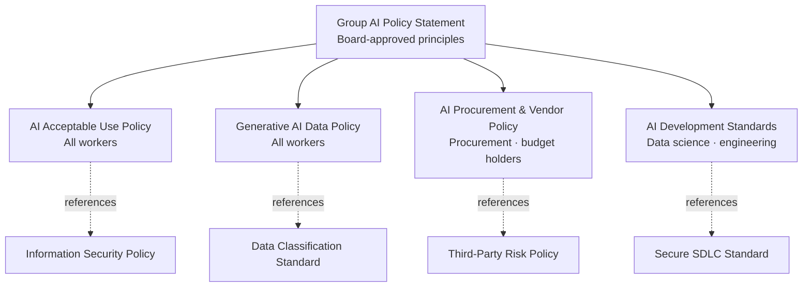

# AI Policy Suite


### BrightPath Retail Group — The policy layer an AI programme actually needs

    

> **Short description:** A four-policy suite — Acceptable Use, Procurement & Vendor, Development Standards and Generative AI Data — written for a 26,000-employee retailer where generative AI arrived bottom-up with no rules. Every clause traces to a documented governance gap, so the suite is defensible to auditors and proportionate for the business.

---

## 1. Organisation Context

| Attribute | Detail |
|---|---|
| Organisation | BrightPath Retail Group (fictional) |
| Sector | Omnichannel retail — grocery, home and apparel |
| Footprint | ~420 stores across the UK and Ireland, e-commerce platform, ~26,000 employees |
| AI landscape | Demand forecasting and dynamic markdown models (internal); personalisation engine (vendor); widespread ad-hoc use of public generative AI tools by marketing, merchandising, HR and store managers |
| Regulatory context | UK GDPR & Data Protection Act 2018, EU GDPR (Irish operations), EU AI Act (Irish market), PCI DSS v4.0, Consumer Protection from Unfair Trading, Equality Act 2010 |
| Trigger | A merchandising analyst pasted a supplier's confidential cost file into a public chatbot; Internal Audit found **no policy had been breached — because none existed** |

## 2. Objective

Produce the AI policy layer required by **ISO/IEC 42001 Clause 5.2** and **NIST AI RMF GOVERN 1** — not a single generic "AI policy", but the **suite** a real programme needs, with each document owned, enforceable and mapped to the gap it closes.

## 3. Scope

**In scope**
- AI Acceptable Use Policy — what all workers may and may not do with AI tools
- AI Procurement & Vendor Policy — due diligence before buying AI or AI-enabled products
- AI Development Standards — mandatory standards for internally built models and AI features
- Generative AI / Prompt Data Policy — what data may enter which class of GenAI tool
- Policy-to-Gap Mapping — traceability from each identified gap to the clause that closes it

**Out of scope**
- Detailed technical procedures (referenced, not authored)
- AI risk-assessment methodology (separate standard)
- Training content (requirements defined; materials produced by L&D)

## 4. Approach

| Phase | Activity | Output |
|---|---|---|
| 1. Baseline | 14 stakeholder interviews; survey of 1,200 employees; CASB data review; review of existing InfoSec, Data Protection, Procurement and SDLC policies | Gap register (18 gaps) |
| 2. Architect | Decide policy vs. standard vs. procedure split; avoid duplicating existing policies | Policy architecture |
| 3. Draft | Write four policies with consistent structure, RFC 2119 language (MUST / SHOULD / MAY) | Drafts v0.x |
| 4. Validate | Review with Legal, DPO, CISO, HR, Works Council representatives, Procurement | Comment log |
| 5. Approve & launch | Executive Committee approval; comms plan; mandatory e-learning | Approved v1.0 |

### Policy Architecture



## 5. Deliverables

| # | Deliverable | Audience | Owner |
|---|---|---|---|
| 1 | [AI-Acceptable-Use-Policy.md](AI-Acceptable-Use-Policy.md) | All workers incl. contractors | Chief Information Officer |
| 2 | [AI-Procurement-Policy.md](AI-Procurement-Policy.md) | Procurement, budget holders | Chief Procurement Officer |
| 3 | [AI-Development-Standards.md](AI-Development-Standards.md) | Data science, engineering, product | Chief Data Officer |
| 4 | [Generative-AI-Data-Policy.md](Generative-AI-Data-Policy.md) | All workers | Data Protection Officer + CISO |
| 5 | [Policy-to-Gap-Mapping.md](Policy-to-Gap-Mapping.md) | Audit, Risk Committee | Head of AI Governance |

## 6. Design Principles

1. **Enable, don't just prohibit** — every prohibition is paired with a sanctioned route.
2. **Data-centric controls** — the risk sits in *what goes into* the tool, so the GenAI Data Policy keys off the existing data-classification scheme.
3. **Proportionality** — controls scale with risk tier; low-risk use is not burdened.
4. **No duplication** — the suite references existing InfoSec, privacy and procurement policies rather than restating them.
5. **Enforceable** — every MUST has an owner and a detection or enforcement mechanism.

## 7. Outcomes

| Metric | Before | 90 days after launch |
|---|---|---|
| Documented AI policies | 0 | 4 + policy statement |
| Gaps closed (fully / partially) | — | 15 / 3 of 18 |
| Employees completing AI e-learning | 0% | 87% |
| Consumer GenAI uploads containing Confidential data (DLP) | ~410 / month | ~35 / month |
| AI purchases with completed due diligence | ~10% | 100% of POs > £0 flagged as AI |

## 8. Framework Alignment

| Framework | Reference | Coverage |
|---|---|---|
| ISO/IEC 42001:2023 | Cl. 5.2 AI policy; Annex A.2.2–A.2.4 | Policy suite, alignment with other policies, review cycle |
| ISO/IEC 42001:2023 | A.3.2, A.6, A.7, A.9, A.10 | Roles, lifecycle, data, responsible use, third parties |
| NIST AI RMF 1.0 | GOVERN 1.1–1.7, 2.1, 4.1, 6.1–6.2 | Policies, accountability, culture, third-party risk |
| NIST AI 600-1 (GenAI Profile) | Data privacy, information security, IP risks | Generative AI Data Policy |
| UK GDPR | Art. 5, 22, 25, 35 | Lawfulness, ADM, privacy by design, DPIA |

## 9. Repository Structure

```
brightpath-ai-policy-suite/
├── README.md
├── assets/banner.jpg
├── AI-Acceptable-Use-Policy.md
├── AI-Procurement-Policy.md
├── AI-Development-Standards.md
├── Generative-AI-Data-Policy.md
└── Policy-to-Gap-Mapping.md
```

## 10. Skills Demonstrated

Policy architecture · Policy drafting (RFC 2119) · Data-classification-driven controls · AI third-party risk management · Secure ML development standards · Gap analysis & traceability · Stakeholder consultation

## 11. Disclaimer

BrightPath Retail Group is fictional. Policies are illustrative templates and are not legal advice.

---

