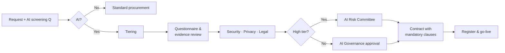

# AI Procurement & Vendor Policy
| Document ID | BPR-POL-AI-002 | Version | 1.0 |
|---|---|---|---|
| Policy owner | Chief Procurement Officer | Approved by | Executive Committee |
| Effective date | 2026-09-01 | Next review | 2027-09-01 |
| Classification | Internal | Related | Third-Party Risk Management Policy; AI Acceptable Use Policy; Data Protection Policy |

---

## 1. Purpose

To ensure that any AI system, AI-enabled product or AI service BrightPath acquires is subject to proportionate due diligence on security, privacy, performance, fairness, legal compliance and exit — **before** contract signature and before data is shared.

## 2. Scope

Applies to all acquisitions, renewals and material changes of:
- Software or services whose primary function is AI (e.g., forecasting platforms, chatbots, GenAI tools)
- Software or services with **embedded AI features** that will process BrightPath data or influence decisions
- AI features added by an existing vendor to a product already in use
- Free tools, trials and pilots, and tools bought on purchasing cards or expensed

## 3. Policy Statements

### 3.1 Identification
1. All procurement requests **MUST** answer the AI screening question: *"Does this product or service use AI/ML, or include AI features that will be enabled?"*
2. Budget holders **MUST NOT** acquire AI tools via purchasing card, expenses, or click-through terms without completing this policy.
3. IT Change Management **MUST** review vendor release notes for new AI features; enablement of a new AI feature is treated as a **material change** and triggers this policy.

### 3.2 Risk tiering
4. Each AI acquisition **MUST** be tiered by Procurement and AI Governance:

| Tier | Criteria | Due-diligence level |
|---|---|---|
| **High** | Influences decisions about individuals (customers or colleagues); processes Restricted data; customer-facing autonomous interaction; pricing; falls under EU AI Act high-risk categories | Full (Sections 3.3 + 3.4) + AI Risk Committee sign-off |
| **Medium** | Processes Confidential or personal data; internal decision support | Full questionnaire + security & privacy review |
| **Low** | No personal or Confidential data; productivity only | Core questionnaire only |

### 3.3 Due-diligence requirements

| Domain | Requirement | Low | Med | High |
|---|---|---|---|---|
| Security | Current ISO/IEC 27001 certificate or SOC 2 Type II; pen-test summary | ✔ | ✔ | ✔ |
| AI governance | ISO/IEC 42001 certification or equivalent AI governance evidence | — | SHOULD | **MUST** |
| Data use | Written confirmation that BrightPath data (inputs, outputs, telemetry) is **not used to train** vendor or third-party models without explicit opt-in | ✔ | ✔ | ✔ |
| Data location | Hosting and sub-processor locations; international transfer mechanism | ✔ | ✔ | ✔ |
| Privacy | DPA executed; DPIA completed by BrightPath where personal data involved | — | ✔ | ✔ |
| Model transparency | Model card / system documentation: intended use, limitations, training data provenance summary | — | ✔ | ✔ |
| Performance | Evidence of accuracy on relevant use; BrightPath-data pilot results with agreed acceptance criteria | — | SHOULD | **MUST** |
| Fairness | Bias testing methodology and results for affected groups | — | — | **MUST** |
| Human oversight | Ability to review, override and switch off AI outputs/features | — | ✔ | ✔ |
| Logging | Access to logs of inputs, outputs and decisions sufficient for investigation | — | SHOULD | **MUST** |
| GenAI-specific | Prompt-injection and jailbreak testing; content filtering; IP indemnity for outputs | ✔ (if GenAI) | ✔ | ✔ |
| Regulatory | EU AI Act role and classification statement where Irish operations affected | — | SHOULD | **MUST** |
| Concentration | Identification of underlying foundation-model provider(s) | ✔ | ✔ | ✔ |
| Exit | Data return/deletion, model-output portability, transition support | — | ✔ | ✔ |

### 3.4 Mandatory contract clauses
5. Contracts for Medium and High tier AI **MUST** include:

| Clause | Content |
|---|---|
| C1 No-training | Vendor shall not use Customer Data to train, fine-tune or improve models offered to others |
| C2 Change notification | ≥ 30 days' notice of material changes to models, sub-processors or AI features; right to opt out of new AI features |
| C3 Transparency | Provision and maintenance of system documentation and model cards |
| C4 Audit & logs | Right to audit (or receive independent reports) and access to relevant logs |
| C5 Incident notification | AI incidents (harmful outputs, data leakage, significant performance degradation) notified within 72 hours |
| C6 Regulatory cooperation | Cooperation with regulator requests and EU AI Act obligations as applicable |
| C7 IP & indemnity | Warranty and indemnity regarding third-party IP in outputs (GenAI) |
| C8 Performance | Service levels for accuracy/availability where performance is material |
| C9 Exit | Deletion certificate; return of data and configurations |

### 3.5 Ongoing management
6. Vendor owners **MUST** reassess High-tier AI vendors annually and Medium-tier every two years, or on material change.
7. Approved AI products **MUST** be registered in the AI Tool Register and AI Inventory before go-live.

## 4. Roles

| Role | Responsibility |
|---|---|
| Budget holder / requester | Initiate request, define use case, own vendor relationship |
| Procurement | Enforce process; contract clauses; supplier onboarding |
| AI Governance | Tiering; AI-specific review; register entry |
| Information Security | Security assessment |
| DPO | Privacy review; DPIA |
| Legal | Contract terms; IP; regulatory |
| AI Risk Committee | Approve High-tier acquisitions |

## 5. Process Summary

## 6. Non-Compliance
Purchases made in breach of this policy will be suspended pending review. Repeat breaches are reported to the Audit Committee.
